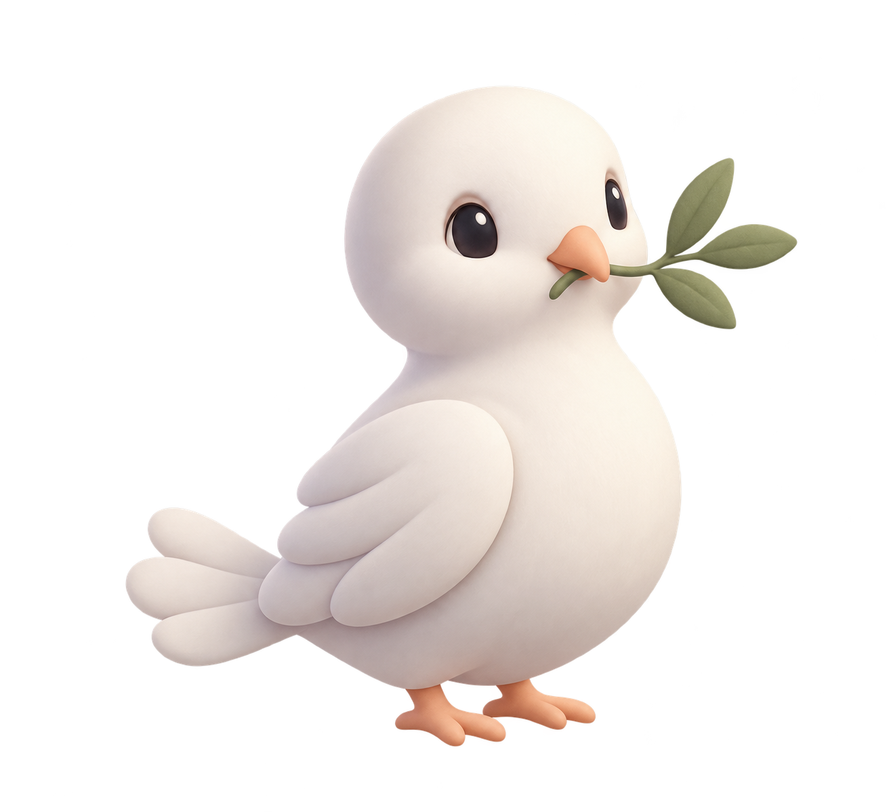

# Master mascot option B — Ollie, the hopeful dove

**Approved replacement reference:** the owner chose Option A, `design-concepts/ollie-a-clean-graphic.png`, and confirmed it by screenshot. Use [DOVE_STYLE_EXPLORATION.md](DOVE_STYLE_EXPLORATION.md). The biblical meaning and placement guidance remain applicable; the original sculpted finish below is historical.

Date: 2026-10-25. Status: original visual concept, offered as an alternative; not an approved replacement of the sheep. Working app name remains Prayer Wall. Read alongside MASTER_PLAN.md. This supplement overrides any assumption that sheep is the only candidate.

## Meaning and biblical accuracy

Inspired by Noah's dove in Genesis 8:8–12. Verse 11 describes a freshly plucked olive leaf; Noah understands that the waters have receded. A small olive sprig is our visual interpretation, not a literal quotation or a claim that the dove announced the distance to dry land.

Source: https://www.biblegateway.com/passage/?search=Genesis+8%3A8-12&version=NET

Brand meaning: hope during waiting, encouragement, renewed beginnings, and carrying care between people. The mascot never speaks for God, guarantees an answered prayer, or implies that saving a prayer sends it to God. Completion means the person prayed today, not that their request has been fulfilled.

## Original identity

Candidate name: **Ollie**, from olive. Alternatives: **Olive** (gentle and direct), **Pip** (small and friendly). These are proposals, not biblical names or approved app renames.

Warm ivory rounded body; soft tapered head; charcoal oval eyes with small highlights; muted peach short beak and feet; broad three-lobe folded wings; short fan tail; sage sprig with three leaves. Matte sculpted finish, soft upper-left light, restrained lavender-grey shadow. No costume, halo, outline, watercolor, glitter, feather micro-detail, or extra ornaments. Retain these proportions, colors, and silhouette across all poses. The generated first concept has larger eyes and more feather lobes than the ideal small-size derivative; simplify those details when preparing that derivative without changing identity.

## Placement and restraint

- Today: one 112–144 px perched dove alongside “A moment to pray”; checklist remains visible first.
- Welcome: a larger arriving pose with an olive sprig, beside short introductory text.
- Empty personal prayers: resting pose; “Make room for a prayer” and a real Add prayer action.
- Saved journal reflection: small calm pose with factual “Reflection saved.”
- Community support: a small wing-open pose after a real pray/support action, never a fabricated message delivery state.
- Android widget: static 40–48 px simplified silhouette; omit the sprig if illegible. Checklist and touch areas take priority.

Maximum one lead character and two small supporting illustrations per viewport. Use the existing borderless lilac, blue, butter, and mint surface system. Do not add dove wallpaper, feather confetti, or repeated decorative birds. Preserve the app's functional hierarchy and system theme.

## Static poses first, optional motion later

Master: perched with sprig. Derived poses: quiet reflection with slightly lowered head, welcome with wings partly open, and restrained acknowledgement with a small head tilt. Each must reference this master image; no independently redesigned birds.

Optional meaningful motion: a single soft blink after settling; a slight head tilt on acknowledgement; one small wing lift on welcome. No continuous flying, flapping, bouncing, or automatic distracting loops. Disable nonessential motion under reduced-motion preferences. Android widget remains static.

This PNG is static, not an animated SVG. For Claude's future motion handoff, supply an authored layered vector with stable groups: body, head, eyes-open, eyes-closed, wing-near, wing-far, tail, feet, beak, olive-stem, olive-leaves. Use Flutter animation or an explicitly supported animation format; do not assume SVG SMIL will animate in a Flutter SVG renderer. Keep the static PNG fallback. Do not simulate independent blinking by deforming the whole raster image.

## Choosing between the candidates

| Candidate | Strongest meaning | Best role |
|---|---|---|
| Sheep | Being cared for, belonging, the flock | Warm personal companion |
| Dove | Hope while waiting, encouragement, renewal | Prayer Wall's communication and community identity |

Recommendation for the owner's message-delivery idea: the dove is the stronger lead. If selected, keep sheep as an occasional supporting biblical asset rather than a competing master. Until selected, retain both concepts and keep layout/components independent of mascot choice. No additional approval checkpoint is required for continuing the already-authorized general redesign.

## Provenance and generation

Original concept produced with the built-in Image Generation tool, not copied from the supplied references. File: `design-concepts/ollie-dove-master-v1.png`. Intended use: concept comparison; not yet wired into app or assessed at native widget size. No animation or vector source exists yet.

Generation prompt:

> Create one original premium app mascot concept: a small cute ivory dove holding a delicate olive sprig in its short muted peach beak. Full body, three-quarter view, perched, compact rounded pear-shaped body, large gently rounded head, two tiny dark charcoal oval eyes with restrained highlights, small folded wings with only three broad feather lobes, short fan tail, tiny peach feet. Olive sprig has three simple muted sage green leaves, clearly visible. Matte sculpted designer vinyl aesthetic, soft smooth dimensional forms, diffuse upper-left studio light, subtle lavender-grey shading, crisp silhouette. Warm quietly hopeful expression; professional contemporary character design for a Christian prayer app, adorable but restrained, not babyish. No clothes, no halo, no text, no letters, no scenery, no border, no sparkles, no watercolor, no painterly texture, no realistic feather detail, no glossy plastic. Center single character with generous transparent margin, genuine transparent background. Static master mascot candidate suitable for small UI hero and matching simplified icons. Character silhouette must read as dove not duck or chicken.
