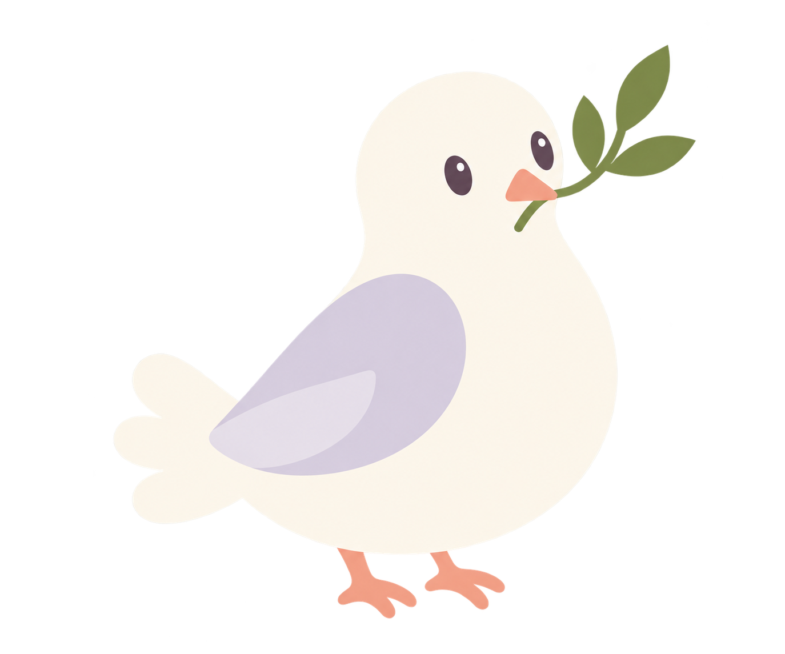
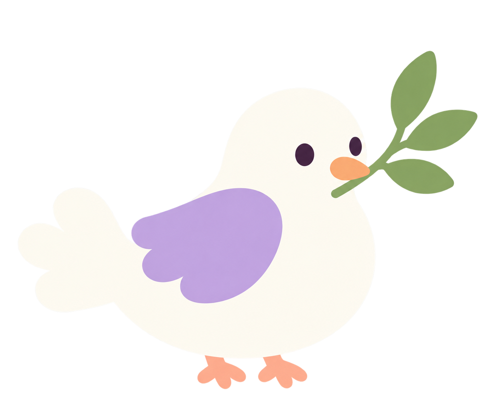

# Dove mascot — flatter art direction

**Owner selection:** Option A is approved as the master visual reference, confirmed with an uploaded screenshot on 2026-10-25. The recommendation for C below is historical and superseded. Use `design-concepts/ollie-a-clean-graphic.png`, not the original 3D concept. Keep B/C for design history only.

Updated 2026-10-25. Owner correction: the initial dove is too three-dimensional. Its sculpted material must not be treated as the chosen style. Three new original PNG concepts explore simpler graphic treatment. No final mascot choice has been made by the owner.

## Reference interpretation

Reference 07 supplies broad flat shapes, sparse facial marks, a limited palette, and simplified animal anatomy. Reference 02 supplies expressive graphic faces and selective soft gradients. Reference 04 supplies bold flat silhouettes. Reference 05's physical toy rendering should not govern the new dove. Preserve modern borderless UI, generous space, purposeful artwork, and functional prayer content.

## Options, in display order

### A — Clean graphic

Folded teardrop wing, quiet face, compact perched posture. Simplifies feather structure and lighting substantially. Some gradient remains in the raster output, so this is vector-like concept art, not truly flat SVG.

### B — Soft expressive

Raised wing and eyebrows communicate welcome. Most expressive of the set; still contains visible dimensional shading. Useful as an onboarding exploration but less faithful to the flat reference and less suitable for frequent checklist placement.

### C — Bold flat — recommended working direction

Simple plum eyes without glossy highlights, broad lavender wing, clean fan tail, clear olive sprig, minimal internal detail. Closest to the flat sheep reference. The generated PNG retains slight tonal variation; a future authored vector should use uniform fills. Recommend C's graphic grammar for continuing the UI; owner has not approved a final character or name.

## Consistency rules replacing the sculpted default

- Graphic 2D organic silhouettes; broad filled regions; minimal shading. Do not return to the original toy render as the master reference.
- Ivory body, lavender wing, muted peach beak/feet, sage olive sprig, dark plum facial marks. No decorative body outlines.
- Only three tail lobes and one wing shape at small sizes. Retain the beak/sprig silhouette; omit fine stem detail at widget size if needed.
- No feather texture, studio shadows, reflective eyes, modeled anatomy, costume, halo, confetti, or decorative scenery.
- Match all derived biblical objects to the selected 2D language. Do not mix flat characters with realistic 3D props.
- One primary character per viewport, 112–144 px in the Today hero. Use a smaller simplified mark at 40–48 px in the widget. Review on light and dark filled surfaces before integration.
- Assets remain static. Future blink should switch simple eye shapes; wing gesture should pivot a separate vector group. Respect reduced motion and avoid continuous loops.

## Delivery and limitations

All three concepts are original images created using the built-in Image Generation tool and saved in `design-concepts/`. C used reference 07 only for its flat visual language. They are transparent-background PNG concept candidates, not SVGs, animated assets, or production-verified widget artwork. The original 3D candidate remains for history only. No app source changes are claimed by this exploration.

## Reproducible prompt records

### A

> Original dove mascot option A for a modern Christian prayer app. STRICT FLAT 2D vector illustration, absolutely no 3D, no realistic lighting, no gradients, no texture, no cast shadow. A friendly compact ivory dove in a side three-quarter pose holding a small sage olive sprig with three flat leaves in a tiny muted peach triangular beak. Chubby simple pear silhouette, rounded head, two small dark plum oval eyes, tiny peach feet, short three-lobe tail, a single pale lavender teardrop folded wing with one flat secondary shape. Broad clean organic curves, minimal shapes, tasteful asymmetry, calm gentle expression, no exaggerated huge glossy eyes. Premium friendly editorial vector mascot, inspired by the simplicity of flat children's animal graphics but refined for adult app UI. No outlines around body, no clothing, no halo, no scenery, no text, no mockup. One centered isolated full-body character on genuinely transparent background, generous margin. This should look like an SVG illustration, not a toy render.

### B

> Design original dove mascot option B for a polished modern prayer app. Entirely 2D soft graphic illustration with very subtle airy color gradients ONLY, no modeled 3D form, no clay, no vinyl toy, no realistic feathers or surface texture. Bold charming flat face with two small black bean eyes and slightly lifted tiny curved eyebrows; tiny peach beak holding a simple sage olive twig with three broad leaves. Compact cream bird like a rounded organic droplet, one friendly raised wing made of a single scalloped shape, short fan tail, tiny peach feet. Soft lilac shading only as a broad graphic color patch at lower body, otherwise white ivory. Expressive friendly character like contemporary playful blob-based app branding, grown-up refined cute. Clear simple silhouette recognizable at 48 px, asymmetrical pose, no huge glittering eyes, no clothing, no halo, no text, no UI mockup, no scenery, no outline around silhouette. Single isolated whole character centered with generous margin on genuine transparent background. Flat vector-like artwork, not a render.

### C

> Create an original dove bird mascot in STRICTLY FLAT SOLID COLOR vector cartoon style. Reference image is STYLE ONLY: use its clean flat color regions, simple oval eyes and bold simplified animal shape, do not recreate the sheep or any screenshot UI. Subject is a NEW ivory white dove carrying a small olive sprig. Make it very graphic and minimal: simple white rounded body with plump belly, head flowing into body, short tail of three rounded lobes, one solid lavender scalloped folded wing, a small solid apricot beak, sage olive stem with exactly three broad solid leaves, tiny dark plum round eyes, two tiny peach feet. Perched facing right, gentle confident calm personality. Large clean cut-paper-like filled shapes. ZERO gradients, ZERO shading, ZERO lighting, ZERO highlights, ZERO texture, ZERO 3D rendering, ZERO cast shadows. Colors perfectly uniform like SVG paths. No outer outline, no background scene, no text, no device, no halo. Only one whole bird centered with transparent background. This is a modern brand character designed in vector drawing software, not an illustration of a physical figurine.
