# Visual reference index

Read with [MASTER_PLAN.md](MASTER_PLAN.md). These eighteen owner-supplied references and confirmation/bug screenshots are retained in this durable folder. References 13–18 record the latest focused refinement; 09–12 record the social redesign request; 08 locks the dove identity. Use them as visual inspiration, not production artwork. Do not ship screenshots, copy branding, trace commercial characters, or assume redistribution rights. Review rights before publishing references in a public repository.

## 01 — Lavender planner

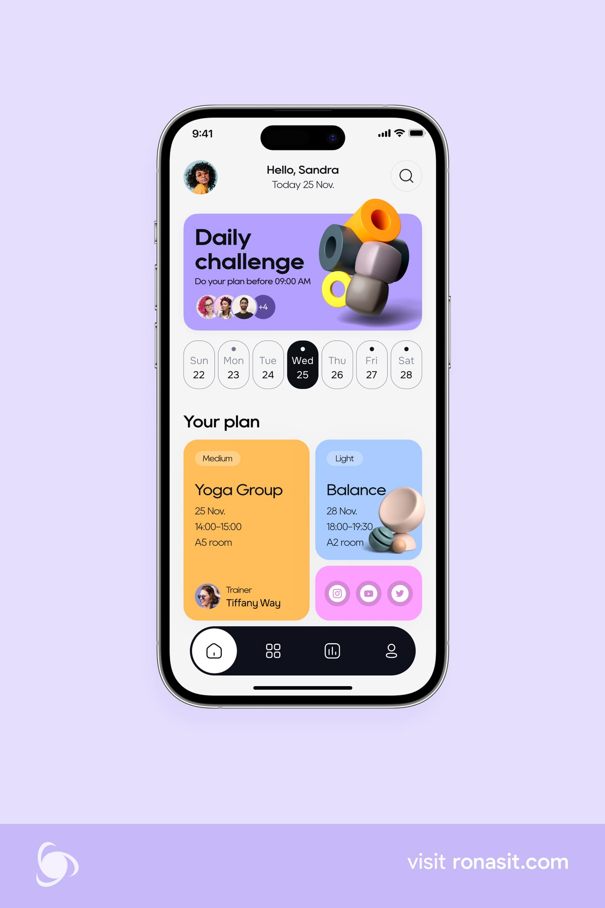

Apply confident geometric typography, functional color blocks, asymmetric composition, controlled object overlap, and capsule navigation. Ignore the presentation background. Replace outlined controls with filled treatments.

## 02 — Moimoi characters

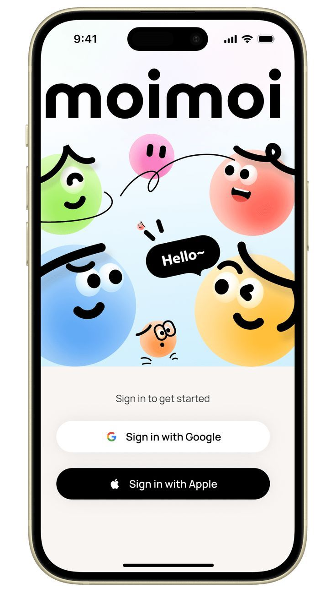

Apply simple expressive faces, strong silhouettes, varying character scale, and calm functional controls. Do not copy the wordmark or characters.

## 03 — Lime mascot

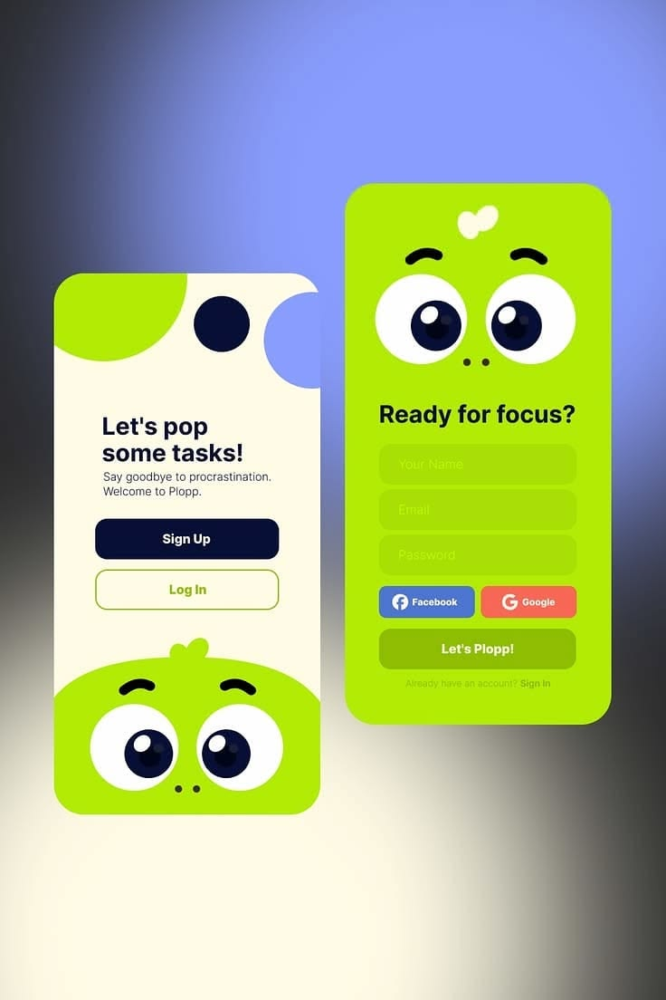

Apply recognition through eyes, tuft, and silhouette. Avoid full-screen neon intensity and low-contrast fields.

## 04 — Classroom community

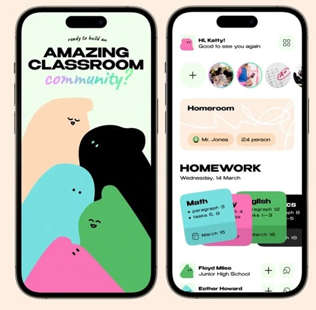

Apply belonging and grouped characters. Keep real prayer text level, readable, and unobstructed; do not adopt overlapping task cards literally.

## 05 — Sculpted toy characters

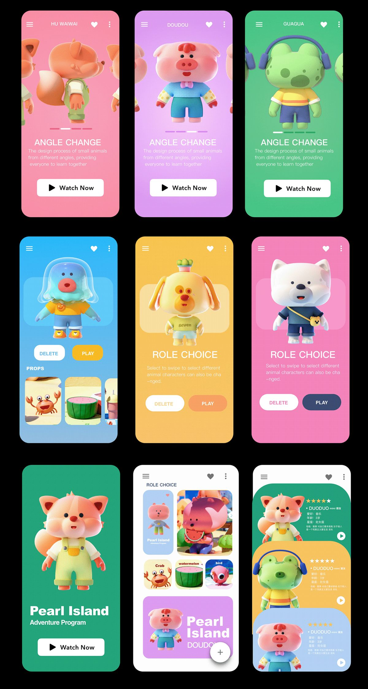

Primary material reference: soft matte forms, large heads, compact limbs, simple expressions, consistent studio light. Do not copy character designs or introduce a toy marketplace.

## 06 — Functional health interface

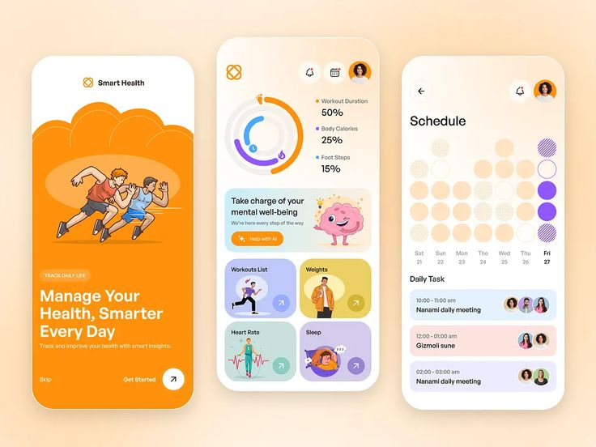

Apply illustrations with clear roles, colored category surfaces, restrained information design. Do not import health metrics or competitive scoring into prayer.

## 07 — Sheep vector inspiration

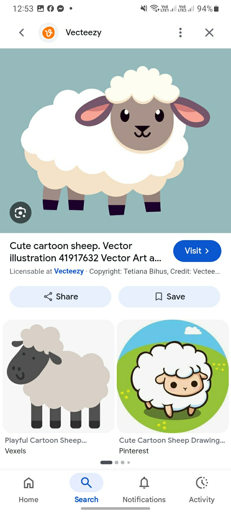

New owner-supplied reference. Main sheep uses scalloped wool, cream underside, taupe face, dark hooves/ears, peach inner ears, oval highlighted eyes, and a small curved mouth. Strong silhouette is readable on a quiet blue-green background. Apply clarity and simplification to our original sheep. Browser chrome and smaller alternative thumbnails are not a combined style requirement. The screenshot identifies licensable artwork; do not use it as a production asset.

Historical sheep candidate only. The owner-selected Option A dove in 08 supersedes this as the main identity; the new lamb is a supporting biblical sticker in the matching graphic family.

## 08 — Owner-confirmed master dove

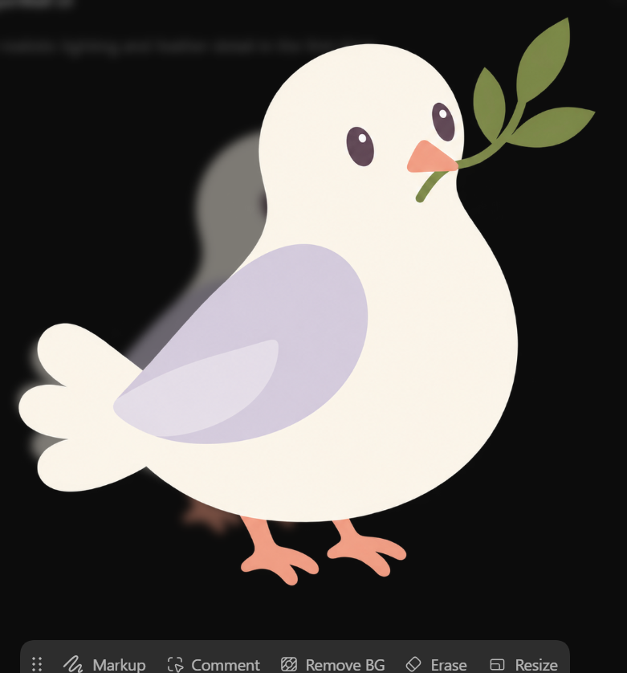

The owner confirmed Option A, the clean graphic dove, with this screenshot. Use the clean original at `design-concepts/ollie-a-clean-graphic.png` and app copy `assets/illustrations/characters/dove_master_v002.png`; do not use the screenshot's dark editor background or controls as art. This selection supersedes the sheep-master and sculpted-toy material recommendations above. The original seven references still guide typography, filled surfaces, composition, and restraint.

## 09 — Top-inset bug

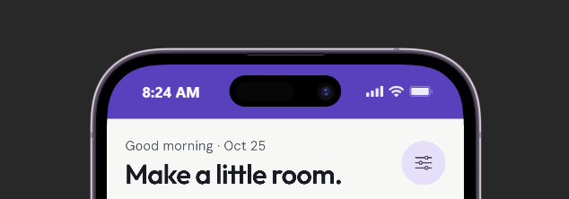

Records the unwanted colored top strip. Source uses the actual canvas for the status-bar overlay, transparent navigation bar, edge-to-edge, SafeArea and matched web ground/theme metadata. Chrome proof does not verify native status bars; Android capture remains pending.

## 10 — Social feed

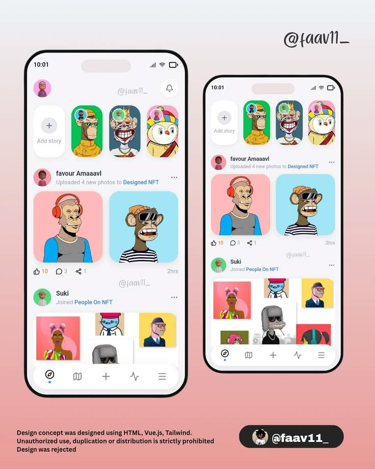

Adopt a confident social author/content/action rhythm, expressive prayer materials and meaningful original stickers. Keep readable live text and accurate sample/local labels. The implemented local composer offers Sticky note, Paper, Formal, Normal and Wall.

## 11 — Social profile

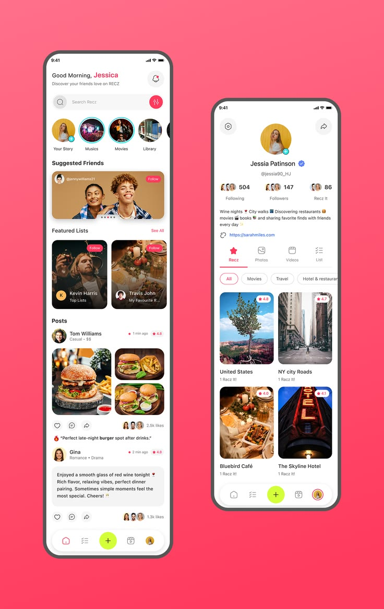

Use a recognizable personal area. Today, Journal and Saved belong inside Profile; Wall is the default primary destination. Do not fabricate followers or live account activity from an inspiration screenshot.

## 12 — Community selector

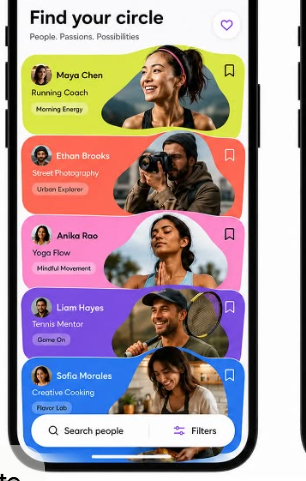

Adopt straight colorful community cards with an arch artwork window taller than a semicircle. Do not introduce waves. Implemented search, Discover/My spaces and detail keep selection local and explicit; artwork is original and matches the approved dove family.

Earlier browser proof: `../design/proofs/social-revamp/`. Current refinement captures/review are tracked separately in IMPLEMENTATION_STATUS.md and `../design/proofs/monochrome-refinement/`. Reference screenshots establish requested direction; they are not implementation proof or production assets.

## 13 — Category duplicate bug

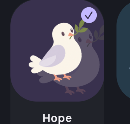

A faded offset copy behind the main dove caused ghosting. Keep one illustration per category tile; do not change the approved master or remove content color.

## 14 — Top strip continuity

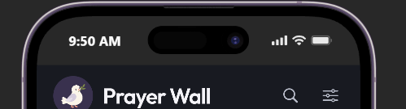

Shows an external phone frame with a charcoal status area above a blue-black app. Owned app layers now use the same neutral dark canvas and matching source overlay/CSS/metadata. The original external frame was not verified: Computer Use stopped because Chrome URL verification failed. Do not claim the frame was inspected, modified or fixed. Native capture remains required.

## 15 — Profile avatar and category meaning

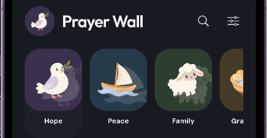

The left avatar opens Profile, using the approved dove until an optional local photo is selected. Add the explicit Prayer categories heading; retain a single meaningful illustration per topic.

## 16 — Black notched dock

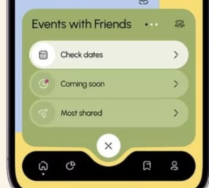

Use a rounded black dock with a real center notch. Retain Prayer Wall destinations and accessible names; do not copy the reference's unrelated events controls or branding.

## 17 — Raised create circle

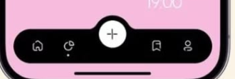

The central white circle is raised into the notch and clearly creates a post. Preserve the surrounding four destinations; this does not authorize a new tab or publication service.

## 18 — Monochrome controls with colorful content

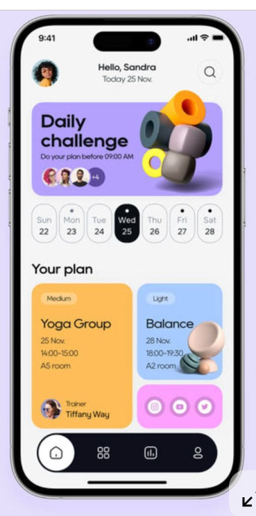

Use neutral/off-white essential controls and black navigation while keeping category/community/material color. Do not reproduce fitness content, people, branding or unrelated artwork. The reference establishes control restraint, not a monochrome app.

## 19 — Plus-button alignment correction

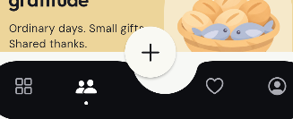

The owner identified a floating create circle sitting above its notch. The outer dock's top padding offset the visible bar from Flutter's centerDocked anchor. Remove the 10 logical-pixel top padding; retain horizontal/bottom safe spacing. Use a 6 logical-pixel notch margin. The button's center must align with the visible dock top, preserving the circular notch and centered plus glyph.
